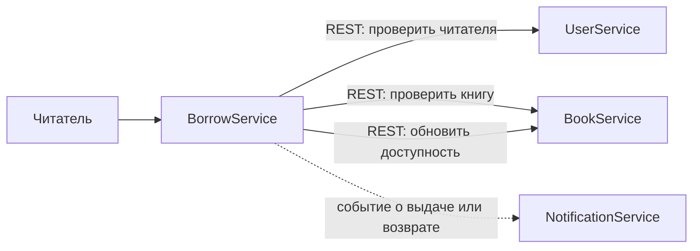

# КТ-2. План декомпозиции библиотеки

## Часть A. Что делим

В монолите сейчас всё рядом: книги, читатели, выдача и уведомления. Если поменять одну штуку, легко задеть соседнюю. Поэтому делим не просто по папкам, а по тому, кто за какую функцию отвечает

## Часть B. Сервисы

| Сервис | Что делает | Своя база |
|---|---|---|
| `BookService` | Каталог книг и их доступность | PostgreSQL: книги и экземпляры |
| `UserService` | Профили читателей | PostgreSQL: пользователи |
| `BorrowService` | Выдача и возврат книг | PostgreSQL: записи выдачи, `bookId`, `userId` |
| `NotificationService` | Напоминает о сроке возврата | PostgreSQL: настройки и история уведомлений |

У каждого сервиса своя база. `BorrowService` хранит только ID книги и читателя, а в чужие таблицы не лезет. Так меньше шансов случайно всё связать в один большой ком

## Часть C. Кто с кем говорит

Сценарий такой: `BorrowService` проверяет читателя, спрашивает у `BookService`, доступна ли книга, и после выдачи обновляет её статус. Уведомления лучше слать событием: если рассыльщик временно упал, выдача всё равно проходит

## Часть D. Как переезжать

1. Составить карту функций, таблиц и связей монолита. Типа понять, что от чего зависит, до того как что-то переносить
2. Сначала разложить код по будущим сервисам, но пока оставить приложение работающим как раньше
3. Вынести книги и пользователей в отдельные сервисы и базы. Проверить, что данные совпадают со старой системой
4. Перенести выдачу в `BorrowService` и заменить прямые обращения к таблицам вызовами API
5. Подключить уведомления, переключать трафик постепенно и держать план отката. Так простой будет минимальным. Когда всё стабильно, удалить старый код

Короче, не переписываем библиотеку целиком за один раз: переносим по частям и проверяем после каждого шага

## Часть E. API и данные

- `BookService`: `GET /books/{id}` и `PATCH /books/{id}/availability`.
- `UserService`: `GET /users/{id}` и `POST /users`.
- `BorrowService`: `POST /borrowings` с `bookId` и `userId`.
- `NotificationService` получает события `BookBorrowed` и `BookReturned`.

Базы PostgreSQL отдельные у каждого сервиса, общих таблиц нет. Для такой библиотеки обычного SQL хватает; CQRS и Event Sourcing тут только усложнят проект.

## Часть F. Сбои и безопасность

Если книга уже занята, `BorrowService` отвечает `409`; если сервис временно недоступен, запрос завершается по таймауту с `503`. Повторяем только безопасные запросы. Если запись выдачи не сохранилась после обновления книги, возвращаем ей прежний статус. Для двух одновременных запросов проверку и смену статуса надо сделать атомарно, иначе одну книгу могут выдать дважды. Уведомления при сбое отправляются повторно, дубликаты отсекаются.

Вход пользователя проверяется по JWT-токену, права на изменение каталога есть только у сотрудника. Пароли храним только в виде хеша, секреты не пишем в логи. Для запросов используем HTTPS.

## Часть G. Документация

Контракты REST описываем в OpenAPI: поля запросов, ответы и коды ошибок. Ещё фиксируем схему сервисов и событий. В логах используем общий `correlationId`, чтобы было понятно, где сломался запрос.

## Часть H. УТОЧНЕНИЯ

### Взаимодействие между сервисами

- Для событий `BookBorrowed` и `BookReturned` используем брокер сообщений RabbitMQ или Kafka
- События передаются через отдельный топик или exchange с версией схемы события
- Для внешних клиентов добавляем API Gateway: он маршрутизирует запросы, проверяет JWT и ограничивает частоту запросов
- Синхронные REST-вызовы между `BorrowService`, `BookService` и `UserService` имеют таймаут и ограниченный размер запроса

### Отказоустойчивость и мониторинг

- Для временных ошибок применяем до трёх повторных попыток с увеличивающейся задержкой
- Для недоступных сервисов используем circuit breaker, чтобы не создавать лавину запросов
- Повторяем только идемпотентные операции или используем `Idempotency-Key` для повторяемых команд
- Каждый сервис предоставляет health check и метрики: количество запросов, ошибки, задержки и состояние базы данных
- Логи отправляются в централизованное хранилище и содержат `correlationId`, идентификатор события и результат операции
- Для событий используем Outbox Pattern, чтобы запись о выдаче и публикация события не расходились при сбое

### План миграции и откат

- Перед каждым этапом делаем резервную копию данных и проверяем процедуру восстановления
- На время перехода используем feature flag и можем направить трафик обратно в монолит
- После переноса включаем теневое чтение или сравнение результатов старой и новой системы
- Если требуется одновременная запись, временно используем dual-write с контролем расхождений
- Переход на новый сервис выполняем постепенно: тестовая группа, небольшая доля пользователей, затем весь трафик
- Критерии успешности этапа: отсутствие расхождений данных, допустимый процент ошибок и заданное время ответа

### Безопасность

- JWT выпускает отдельный OAuth2/OIDC-сервер; сервисы проверяют подпись, issuer, audience и срок действия токена
- Роли разделяются явно: читатель может работать со своими выдачами, сотрудник изменяет каталог, администратор управляет пользователями
- Секреты и ключи хранятся во внешнем хранилище секретов и не попадают в репозиторий или логи
- Для API включаем валидацию входных данных, ограничение размера тела запроса, rate limiting и защиту от повторной отправки команд

### Контракты и тестирование

- Для каждого endpoint документируем пример запроса, пример ответа и коды `200`, `201`, `400`, `401`, `403`, `404`, `409`, `503`
- Для событий фиксируем JSON-схему, обязательные поля, версию и правила обратной совместимости
- Добавляем contract-тесты REST API и интеграционные тесты основного сценария: активный пользователь получает доступную книгу, после выдачи книга становится недоступной
- Отдельно проверяем ошибки: неактивный пользователь, отсутствующая книга, занятая книга, недоступность зависимого сервиса и повторная доставка события